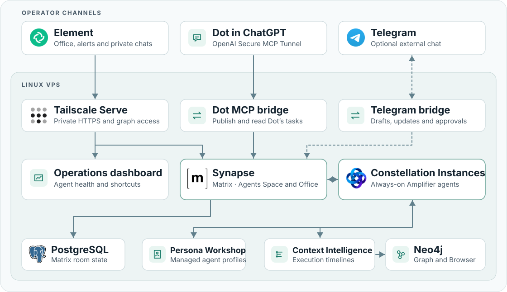
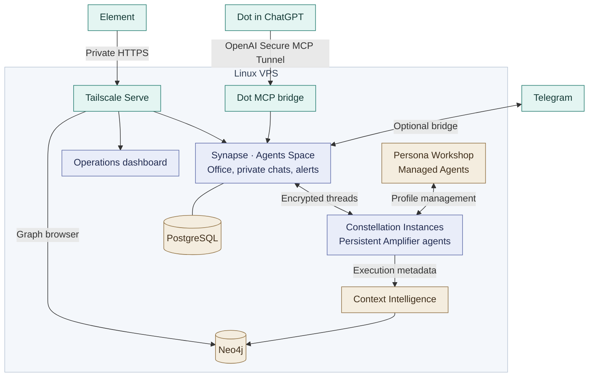
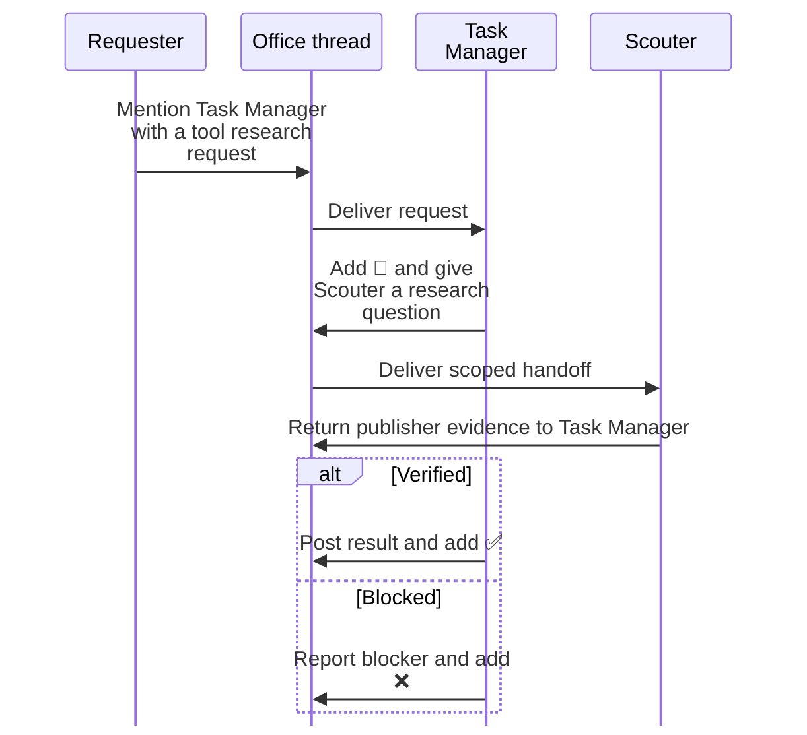

# Always-on Constellation via Matrix

**A private workspace for a team of always-on AI agents.**

Assign work in Element or from Dot in ChatGPT. The agents coordinate in one encrypted Office thread, share files and evidence, and return a verified result to the original request. The team runs on a Linux VPS and stays available when your laptop is offline.

[Quick start](#quick-start) · [Architecture](#architecture) · [Follow an Office task](#follow-an-office-task) · [Deployment scenarios](docs/acceptance.md#post-deployment-scenarios)


## Architecture

Each agent has a Matrix identity, a private workspace, and a persistent Constellation Instance running Amplifier. The **Agents** Space groups **Office**, **VPS Alerts**, and the operator’s private chats with **Hiring Manager**, **Coach**, **Scouter**, and **VPS Manager** (in **Root Operations**). General Office workers also share a desktop for task files.



<details>
<summary>Service connections in Mermaid</summary>



</details>

## Meet the starter team

| Agent | What to ask it to do |
| --- | --- |
| **Task Manager** | Coordinate an Office request, assign work by capability, and verify the result in the original thread. |
| **Hiring Manager** | Investigate work nobody owns. Review its proposed persona, first assignment, or retirement in its private chat. |
| **Coach** | Investigate a failed handoff. It can revise working style in Persona Workshop and change which teammates an agent may contact. |
| **Scouter** | Find a skill, MCP server, or tool for an existing duty. Approve a scoped proposal in its private chat and see whether the target can use it. |
| **VPS Manager** | Prepare a host change. Review the exact operation in **Root Operations** before it runs. |

Open the dashboard from **Agents → VPS Alerts → Workspace shortcuts**. Choose **Persona and duties** on any roster entry to read its purpose, responsibilities, working style, contact list, and verified tools. Your own specialists appear in the same roster. [Starter team and first interactions](docs/team.md) · [Architecture notes](docs/architecture.md)

## Follow an Office task

Mention **Task Manager** when you want several agents to work on a request. Task Manager sets the acceptance criteria, delegates by capability, and verifies the evidence before closing the task.



An agent adds 👀 when it accepts an assignment and clears it after delivery. A managed task has up to **15 agent replies**, with the final reply reserved for Task Manager. You can ask an agent directly for status without consuming a turn. [Communication policies](policy/README.md)

## Quick start

On an Ubuntu 24.04 VPS, use standard Docker Engine with Compose V2. Start setup as your regular user. The installer invokes sudo for Docker, protected deployment files, and host services. For private access from your devices, connect the VPS to your tailnet and enable Tailscale HTTPS. [VPS setup](docs/runbook.md#initial-setup) · [Docker Engine](https://docs.docker.com/engine/install/ubuntu/) · [Tailscale Serve](https://tailscale.com/docs/features/tailscale-serve)

```sh
./constellation_matrix install
```

Choose your network and Matrix username, then enter and confirm your Matrix password. Choose your integrations and set a dedicated Context Intelligence password. The installer deploys the workspace and shows how to sign in to Element Desktop.

After confirming Element sign-in, use the arrow keys and Enter to review the five preselected starter agents. Toggle any of them with Enter, then choose **Done**. The installer registers the roster and opens Amplifier provider setup for each local agent. After everyone is ready, Hiring Manager sends a private welcome when selected. Otherwise, an available Office agent sends the welcome in Office. The welcome links to the **Workspace shortcuts** pin in **Agents → VPS Alerts**.

On a systemd VPS, management becomes available as the selected agents activate. The operator decides hires, retirements, protected contact changes and tool grants in encrypted private chats. Coach can apply and undo ordinary working-style and contact improvements. [Decisions and examples](docs/team.md#first-interactions)

If agent sign-in was interrupted, resume it from the same checkout.

```sh
./constellation_matrix agent configure
```

Run `./constellation_matrix setup-guide` to resume or append `--print` for the Element sign-in instructions and guide locations. [Finalize your setup](docs/setup-guide.md) · [Element setup](docs/runbook.md#connect-in-element)

### Finish in Element

- **Agents → VPS Alerts → Pinned messages.** Open **Workspace shortcuts** for the dashboard and Context Intelligence. If you enabled Dot, open **Connect Dot** to configure the private Constellation Office plugin.
- **Telegram → Telegram Control → Pinned messages.** If you enabled Telegram, the installer joins your account to both the Space and Control. Open **Set up Telegram**. **Telegram Bridge** and each verified chat appear in this Space as you connect them. [Telegram setup](docs/telegram.md)

### Send your first task

Task Manager is the entry point for coordinated Office tasks. Open **Agents → Office** in Element, select `@Task Manager` from the mention picker, and send “@Task Manager, coordinate a three-step checklist for getting started in Office and post the result in this thread.”

If you enabled Dot, open a ChatGPT conversation with the **Constellation Office** plugin and ask “Dot, send this task to Office starting with Task Manager: coordinate a three-step checklist for getting started and post the result in the Office thread.” [Dot setup](docs/dot.md)

If you skipped Task Manager, use the Office agent named in your welcome. If you skipped the Office roster, add a worker first. [Add a worker](docs/runbook.md#add-a-worker)

**ChatGPT via Codex is the only provider tested with a live account.** Anthropic and OpenAI API-key setup have been exercised with synthetic credentials.

For unattended provisioning, edit the example configuration, check it with `./constellation_matrix validate --config <file>`, and run `sudo ./constellation_matrix install --config <file>`. Run `setup-guide` from an interactive terminal afterwards. [Example configuration](deploy/config.example.json)

The installer enables startup at boot. Docker restarts application containers, Tailscale Serve serves the static dashboard, and systemd runs the host services, including the Dot tunnel once connected. [Boot and service placement](docs/runbook.md#boot-and-service-placement)

### Remote worker setup

Use the same checkout on the VPS and on an Ubuntu worker joined to your tailnet.

1. **Worker.** Install Docker Engine with Compose V2, Tailscale, and SSHFS. Generate a dedicated Ed25519 key for the shared desktop.
2. **VPS.** Register the optional [remote worker profile](agents/examples/remote-worker.json), authorize the worker’s public key with `remote desktop`, and create its private enrollment with `remote export`.
3. **Worker.** Verify the VPS desktop host key, mount the shared desktop, and run `remote attach`. Complete Amplifier sign-in and send the resulting files back to the VPS.
4. **VPS.** Run `persona-connect` and `remote confirm`. Check that the worker is registered, then verify an Office handoff and a shared-file round trip.

[Copyable commands for both machines](docs/runbook.md#add-a-remote-worker)

## Operate and extend

| Task | Start here |
| --- | --- |
| Check the stack | Run `./constellation_matrix status` for the latest dashboard snapshot, or use **Agents → VPS Alerts → Pinned messages** to open the dashboard or Context Intelligence. |
| Add a local Office worker | Run `sudo ./constellation_matrix agent add --profile /path/to/agent.json --configure`. This opens native Amplifier sign-in after provisioning. See [agent profiles](docs/runbook.md#add-a-worker) and the [shared desktop](desktop/README.md). |
| Retire a local Office worker | Run `sudo ./constellation_matrix agent remove <id>` to finish accepted work, revoke access, and archive the workspace. [Retirement](docs/runbook.md#retire-a-worker) |
| Manage staffing | Ask **Hiring Manager** to hire or retire a teammate and review its exact proposal in the private chat. [Staffing](docs/team.md#first-interactions) |
| Improve handoffs or tools | Ask **Coach** about an Office handoff, or **Scouter** about a missing tool. [Contacts and tool grants](docs/team.md) |
| Upgrade an existing team | Preview with `sudo ./constellation_matrix agent migrate-team`. [Migration and recovery](docs/team.md#upgrade-an-existing-team) |
| Ask for VPS maintenance | Mention **VPS Manager** in Office or ask Task Manager to delegate. Review the action in the private [Root Operations chat](integrations/root/README.md). |
| Trace an Office task | Open [Context Intelligence](integrations/context-execution/README.md) to see who handed off the work, whether the recipient accepted it, and how the original assignee closed the task. |
| Work from ChatGPT or Telegram | [Connect Dot](docs/dot.md) to publish tasks and read their outcomes. Use [Telegram Control](docs/telegram.md) for drafts and updates from approved chats. |
| Test a deployed team | Run the [deployment scenarios](docs/acceptance.md#post-deployment-scenarios), from a single Office task through handoffs, approvals, and recovery. |
| Verify or recover a deployment | Run `status --refresh`, `backup`, and `restore-check` with sudo. See the [acceptance checks](docs/acceptance.md) and [recovery guide](docs/runbook.md#back-up-and-recover). |

## Planned features

- Copy files from workspaces and approved folders to the shared desktop from local and remote agents. The plan includes approval for protected agents. [Shared desktop copy plan](next_features_plans/plan.md#shared-desktop-file-copying)
- Match natural-language requests in ChatGPT or Element to a verified Telegram chat, and ask when several registered chats match.
- Show the full destination in Telegram Control for 10 seconds, then send without a separate approval.
- Attach a named file from the VPS shared desktop to a Telegram message.

[Telegram feature plan](next_features_plans/plan.md#send-telegram-messages-through-dot)

## Uninstall

From the repository on the VPS, remove the workspace services and keep your data and backups.

```sh
sudo ./uninstall.sh
```

For a fresh install, purge the workspace. This permanently deletes its data, backups, and Docker volumes.

```sh
sudo ./uninstall.sh --purge
```

See the runbook for custom data directories and remote workers. [Uninstall options](docs/runbook.md#uninstall)

Built on [Microsoft Constellation](https://github.com/microsoft/amplifier-constellation) and [Amplifier](https://github.com/microsoft/amplifier).
