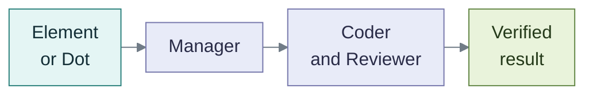

# Always-on Constellation via Matrix Protocol

**Build and run a private workspace for always-on AI agents.**

This repository shows how to deploy a team of specialized agents on a Linux VPS. Give them work from Element or through Dot in ChatGPT, follow their handoffs in one encrypted Matrix thread, and receive the verified result in that same thread.

**[Deploy the stack →](docs/runbook.md#prerequisites)** · [Explore the architecture](docs/architecture.md) · [Verify your deployment](docs/acceptance.md)

## Follow an assignment

Ask Manager to coordinate a change. Manager defines what needs to be checked, Coder implements it, and Reviewer independently checks the evidence. Manager brings their findings together in Element.

The thread holds the request, evidence, and outcome. A status question can go directly to the agent that has the answer. [See how mentions, handoffs, and outcomes work](docs/architecture.md#shared-matrix-policies).

## Meet the team

| Agent | What it does |
| --- | --- |
| **Manager** | Plans one assignment, delegates work, and verifies the result before closing the thread. |
| **Analyst** | Investigates questions and gives the team the context it needs to act. |
| **Coder** | Implements changes in a dedicated workspace and can publish authorized GitHub changes. |
| **Reviewer** | Checks the shared evidence independently and sends findings back to the delegating agent. |
| **External Worker** | Handles tasks that need access to a separate Linux host. Optional. |

**Dot** can open an assignment from ChatGPT through a private connector. **Monitor** sends resource alerts and recovery notices to `VPS Alerts`. [See agent runtimes and operating roles](docs/architecture.md#agent-roles).

## What you deploy

| Layer | What it provides |
| --- | --- |
| **Private access** | Synapse and PostgreSQL in Docker Compose, with Element access over Tailscale and invite-only encrypted rooms. |
| **Always-on workers** | Separate Matrix identities, workspaces, and sessions. Real mentions route work in `Agents`. Rich text and encrypted attachments keep evidence in the thread. |
| **Operations** | A private dashboard for VPS resources and agent inventory, encrypted local backups, and service recovery after a restart. |

> [!NOTE]
> Start with the matching `matrix-stack` and `matrix-agents` installer sources. The [runbook](docs/runbook.md) covers installation order, Element onboarding, optional integrations, and recovery. The [acceptance checks](docs/acceptance.md) record what to verify on your deployment.

## Roadmap

- Define role-specific personas for working style, decision criteria, and tone.
- Design a Chief of Staff that reviews authorized threads and proposes improvements in a separate room.
- Automate new-agent provisioning so registration, shared policies, dashboard inventory, and backups are configured together.
