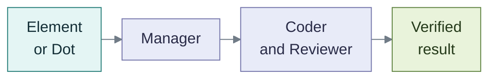

# Always-on Constellation via Matrix Protocol

**Build and run a private workspace for always-on AI agents.**

This repository shows how to deploy a team of specialized agents on a Linux VPS. Give them work from Element or through Dot in ChatGPT, follow their handoffs in one encrypted Matrix thread, and receive the verified result in that same thread.

**[Deploy the stack →](docs/runbook.md#prerequisites)** · [Explore the architecture](docs/architecture.md) · [Verify your deployment](docs/acceptance.md)

## What's new

- **Root Operations** takes reviewed maintenance requests through an operator-only **Accept / Reject** poll in Element. It binds each vote to the exact script and returns the outcome to Manager in the original thread. [Install and verify Root](integrations/root/README.md)
- **Telegram Control** accepts drafts from Dot, reads an authorized chat on request, and keeps follow-up drafts and their approvals in the original Matrix thread. [Telegram operator guide](docs/telegram.md#dot-and-chat-updates)
- **Capability-based routing** lets agents delegate by resource scope and availability. Coder returns runtime failures and useful partial work to Manager for recovery. [Deployment and verification](docs/runbook.md#agent-capability-catalog)
- **Execution timelines** link steps within a task and tasks within a thread, with contributor attribution in Context Intelligence and Neo4j. [Timeline guide](integrations/context-execution/README.md)

## Follow an assignment

Ask Manager to coordinate a change. Manager defines what needs to be checked, Coder implements it, and Reviewer independently checks the evidence. Manager brings their findings together in Element.

The thread holds the request, evidence, and outcome. A status question can go directly to the agent that has the answer. [See how mentions, handoffs, and outcomes work](docs/architecture.md#shared-matrix-policies).

## Meet the team

| Agent | What it does |
| --- | --- |
| **Manager** | Plans one assignment, delegates work, and verifies the result before closing the thread. |
| **Analyst** | Investigates questions and gives the team the context it needs to act. |
| **Coder** | Implements changes in a dedicated workspace and can publish authorized GitHub changes. |
| **Reviewer** | Checks the shared evidence independently and sends findings back to the delegating agent. |
| **External Worker** | Handles tasks that need access to a separate Linux host. Optional. |
| **Chief of Staff** | Observes authorized threads, records team interactions in Context Intelligence, and proposes improvements in its own room. Optional. |
| **Root** | Presents a maintenance proposal in `Root Operations` and reports the result in the requesting thread after the operator's decision. Optional. |

**Dot** can open an assignment from ChatGPT through a private connector. **Monitor** sends resource alerts and recovery notices to `VPS Alerts`. [See agent runtimes and operating roles](docs/architecture.md#agent-roles).

## What you deploy

| Layer | What it provides |
| --- | --- |
| **Private access** | Synapse and PostgreSQL in Docker Compose, with Element access over Tailscale and invite-only encrypted rooms. |
| **Always-on workers** | Server-side listeners stay available with the Mac off. A real mention in `Agents` starts a model turn. Matrix identities, workspaces, and sessions are separate. Rich text and encrypted attachments keep evidence in the thread. |
| **Operations** | A private dashboard for VPS resources and agent inventory, encrypted local backups, and service recovery after a restart. |
| **Team improvement** | The Chief of Staff reviews how work flows across threads. Context Intelligence stores the evidence in Neo4j, and Microsoft Persona Workshop saves reviewable persona drafts. [See how it works](docs/chief-of-staff.md). |
| **Telegram pilot** | Optional private Element portals with a dedicated Constellation and Amplifier drafting agent. [Setup and acceptance](docs/telegram.md). |

> [!NOTE]
> Start with the matching `matrix-stack` and `matrix-agents` installer sources. The [runbook](docs/runbook.md) covers installation order, Element onboarding, optional integrations, and recovery. The [acceptance checks](docs/acceptance.md) record what to verify on your deployment.

## Roadmap

- Run the [four collaboration scenarios](docs/acceptance.md#chief-of-staff-collaboration-scenarios) and evaluate the Chief of Staff's proposals against their evidence.
- Add an operator-initiated draft request from the `Chief of Staff` room.
- Automate new-agent provisioning so registration, shared policies, dashboard inventory, and backups are configured together.

### Amplifier Constellation adoption

Matrix remains the conversation layer. The External Worker already runs Constellation Instance with an Amplifier ACP backend, making it the first pilot for lifecycle, profiles, and diagnostics. Manager, Analyst, Coder, and Reviewer use Codex ACP. [Upstream component map](https://github.com/microsoft/amplifier-constellation) · [Evaluation and acceptance criteria](docs/constellation-evaluation.md)

- [ ] Use ACP Lab's fixture and scenario approach for repeatable engine checks. Establish the Matrix baseline with the four scenarios, including interruption and retry, before changing the agent or connector.
- [ ] Audit the External Worker's Instance and selected ACP engine. Verify stable identity, session loading, model access, and rollback on an isolated copy before an upgrade.
- [ ] Compare one Chief of Staff persona draft against the unprofiled baseline, then test import and rollback on the External Worker after operator review.
- [ ] Pilot Observatory for one Instance with observation-only access. Add live health and the last real task check to the current inventory if the data improves operations.
- [ ] Evaluate a timer for the existing Chief of Staff review after scenario acceptance. A native scheduler pilot must prove authorization, restart recovery, and explicit Matrix delivery. Consider Instance context grants for a concrete, scoped use case.
- [ ] Evaluate Conversations or Huddles in isolation if a use case needs a separate collaboration surface or Companion voice. Preserve Matrix audience, thread identity, and delivery rules in any adapter.
