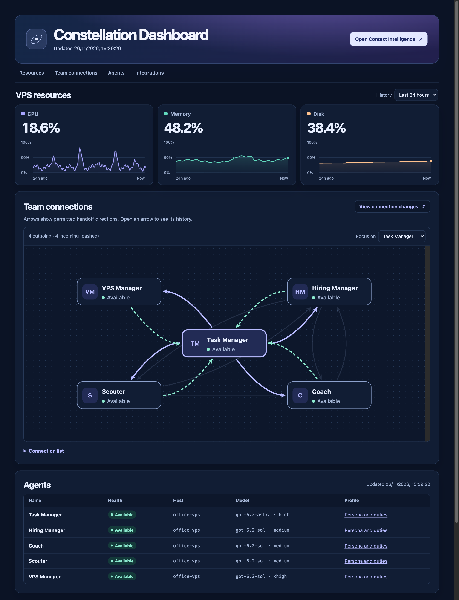
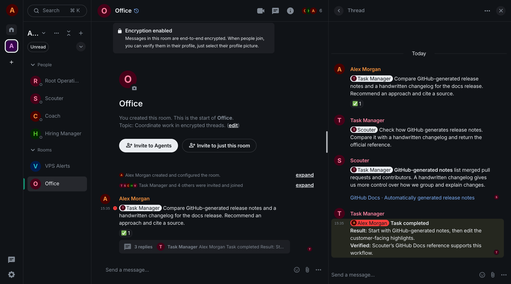
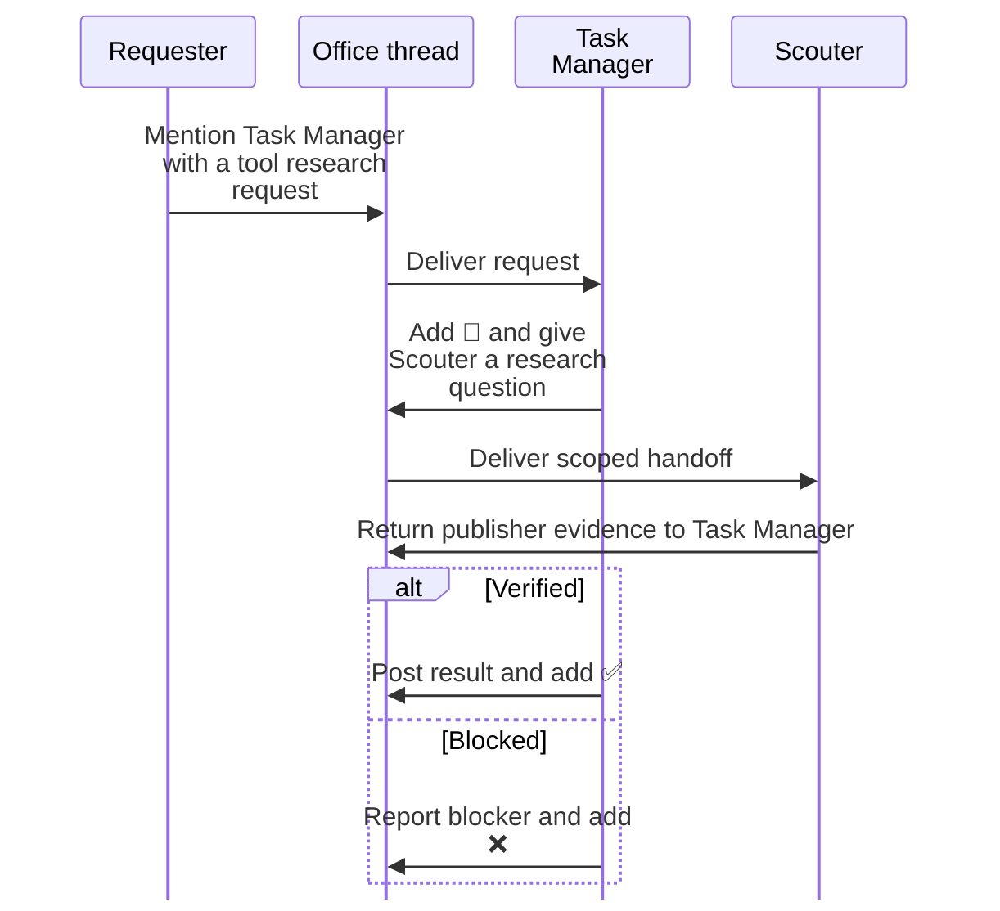
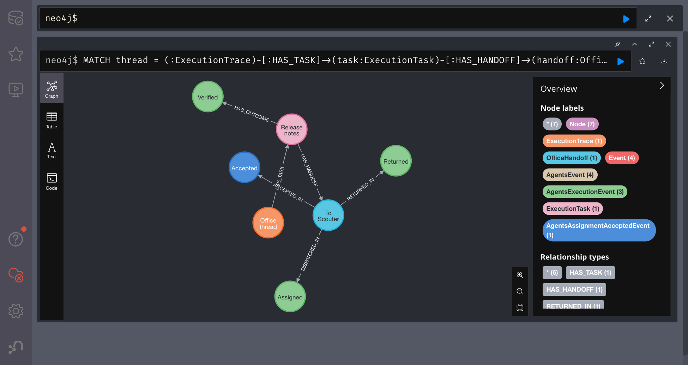
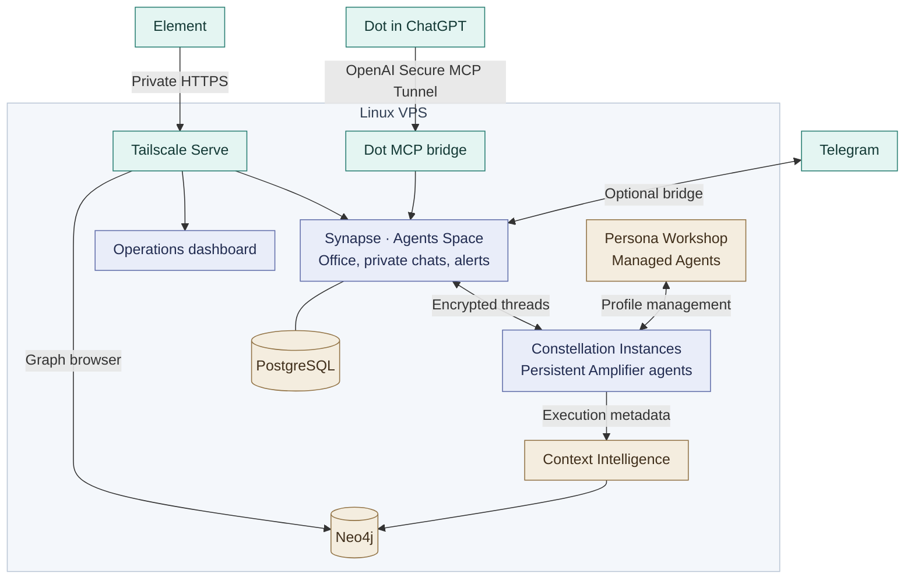

# Always-on Constellation via Matrix

**A private, always-on AI office you can shape around your work.**

Give Task Manager a request in Element or from Dot in ChatGPT. It can assign parts of the work to other agents, keep the handoffs in one encrypted Office thread, and return the result with evidence. The team runs on a Linux VPS and stays available when your laptop is offline.

Start with six roles and add specialists as your work grows. Use the record of real assignments, handoffs, and outcomes to decide when to improve how agents work together, equip an existing agent, or add someone to the team.

[Quick start](#quick-start) · [Starter team](#meet-the-starter-team) · [Office workflow](#follow-an-office-task) · [Architecture](#architecture) · [Deployment scenarios](docs/acceptance.md#post-deployment-scenarios)


## Meet the starter team

| Agent | What it owns | Where to start |
| --- | --- | --- |
| **Task Manager** | Coordinates work, delegates by capability, and verifies the result in the original thread. | **Office** |
| **Hiring Manager** | Groups recurring capability gaps across differently worded assignments and proposes new personas or retirements. | **Hiring Manager** private chat |
| **Coach** | Reviews handoffs in Context Intelligence and revises working styles and permitted contacts through Persona Workshop. | **Coach** private chat |
| **Scouter** | Researches skills, MCP servers, and tools for existing duties and has the target agent verify approved access. | **Scouter** private chat |
| **VPS Manager** | Prepares and verifies host maintenance. The operator votes on the exact operation before it runs. | **Office** for requests, **Agents → Rooms → Root Operations** for approval |
| **Helper** | Answers setup and troubleshooting questions using the deployed guides and dashboard health. | **Agents → People → Helper** |

Open the dashboard from **Agents → VPS Alerts → Pinned messages → Workspace shortcuts**. Select **Persona and duties** on any roster entry to see what it owns, how it works, whom it can contact, and which tools it has verified. **Team connections** shows the permitted directions. Follow an arrow to review that route’s changes and recent Office handoffs, or select **View connection changes** for the workspace log. [Team connections and history](docs/team.md#team-connections) · [Starting contact permissions and role examples](docs/team.md#first-interactions)



*Demo dashboard with sample VPS metrics and Task Manager’s incoming and outgoing routes highlighted.*

## Quick start

From this checkout on an Ubuntu 24.04 VPS, use standard Docker Engine with Compose V2. Start setup as your regular user. The installer invokes sudo for Docker, protected deployment files, and host services. Tailscale Serve gives authorized devices private HTTPS access to Element’s homeserver, the dashboard, and the graph browser. [VPS prerequisites](docs/runbook.md#initial-setup) · [Tailscale Serve](https://tailscale.com/docs/features/tailscale-serve)

```sh
./constellation_matrix install
```

1. **Deploy the workspace.** Choose your network, Matrix username, and integrations. Set your Matrix password and a dedicated Context Intelligence password. If sudo prompts for a password, enter the Linux password for the VPS account shown in the prompt. The installer then displays the homeserver and Element Desktop sign-in instructions.
2. **Choose your team.** Confirm Element sign-in in the terminal. Use the arrow keys to review the six preselected roles, press Enter to toggle any of them, and choose **Done**. The installer uses sudo to save the agent registrations and start local Amplifier containers, then opens Amplifier’s provider and model setup for each local agent in the same terminal.
3. **Open the welcome.** Once the selected agents are ready, Hiring Manager sends a private welcome if selected. Otherwise, a ready Office agent posts it in Office. The welcome points to **Workspace shortcuts**.

ChatGPT via Codex is the only provider tested with a live account. Anthropic and OpenAI API-key setup have been exercised with synthetic credentials.

If agent sign-in was interrupted, resume it from the same checkout.

```sh
./constellation_matrix agent configure
```

Run `./constellation_matrix setup-guide` to resume onboarding or append `--print` for the Element sign-in instructions and guide locations. [Finalize your setup](docs/setup-guide.md)

### Finish in Element

- **Agents → VPS Alerts → Pinned messages.** Open **Workspace shortcuts** for the dashboard and Context Intelligence. If you enabled Dot, open **Connect Dot** to configure the private Constellation Office plugin.
- **Telegram → Rooms → Telegram Bridge → Pinned messages.** Open **Set up Telegram**. Telegram Agent manages the Telegram Space and joins Office as its Telegram specialist. Mention **@Telegram Agent** or **@Task Manager** in Office. Find contacts and groups under **Telegram → People**. Review the verified recipient and exact text in **Telegram Bridge**, then vote **✅ Accept** or **❌ Decline**. [Telegram setup and examples](docs/telegram.md)

### Send your first task

Task Manager is the entry point for coordinated Office tasks. Open **Agents → Office** in Element, select `@Task Manager` from the mention picker, and send “@Task Manager, coordinate a three-step checklist for getting started in Office and post the result in this thread.”

If you enabled Dot, open a ChatGPT conversation with the **Constellation Office** plugin and ask “Dot, send this task to Office starting with Task Manager: coordinate a three-step checklist for getting started and post the result in the Office thread.” [Dot setup](docs/dot.md)

With Dot and Telegram configured, try “Dot, ask Task Manager in Office to send a private Telegram message to Sam Example saying «Hello».” Open the **Telegram Bridge** poll from Dot’s task status or the Office reply. Review the recipient and exact text, then vote **✅ Accept** or **❌ Decline** in Element. [Telegram from Office](docs/telegram.md#use-telegram-from-office)

If you skipped Task Manager, use the Office agent named in your welcome. If you skipped the Office roster, add a worker first. [Add a worker](docs/runbook.md#add-a-worker)

## Follow an Office task

Mention **Task Manager** when you want several agents to work on a request. Task Manager sets the acceptance criteria, delegates by capability, and verifies the evidence before closing the task.



*In this scripted demo, Scouter checks GitHub’s release-notes workflow and Task Manager recommends editing the generated notes before publication.*



An agent adds 👀 when it accepts an assignment and clears it after delivery. A managed task has up to **15 agent replies**, with the final reply reserved for Task Manager. You can ask an agent directly for status without consuming a turn. [Communication policies](policy/README.md)

### Improve the team from its work

Context Intelligence records who handed off an assignment, whether the recipient accepted it, and whether the original task finished or was blocked. During a stalled release task, Scouter can propose narrowly scoped GitHub access for a Coder who already owns repository work. Coach can revise the working agreement if the handoff omitted acceptance criteria. Hiring Manager can propose a release editor if the team repeatedly has nobody responsible for release notes. [Execution timelines](integrations/context-execution/README.md)



*The same demo task in Neo4j Browser. The graph links Task Manager’s dispatch to Scouter’s acceptance and return, and records the verified outcome.*

On a systemd deployment, these management workflows become available as the relevant agents activate. The operator approves hires, retirements, tool grants, and changes to contacts involving VPS Manager in private chats. Coach can apply and undo ordinary working-style and contact changes. [Team workflows](docs/team.md#first-interactions)

## Architecture

Each agent has a Matrix identity, a private workspace, and a persistent Constellation Instance running Amplifier. The **Agents** Space groups **Office**, **VPS Alerts**, and the operator’s private chats with **Hiring Manager**, **Coach**, **Scouter**, and **Helper**. The encrypted approvals room **Root Operations** appears under **Agents → Rooms**. General Office workers also share a desktop for task files.

The installer enables startup at boot. Docker restarts application containers, Tailscale Serve provides private dashboard access, and systemd runs host services, including the Dot tunnel once connected. [Architecture notes](docs/architecture.md) · [Boot and service placement](docs/runbook.md#boot-and-service-placement)


<details>
<summary>Service connections in Mermaid</summary>



</details>

## Operate and extend

For unattended provisioning, edit the example configuration, check it with `./constellation_matrix validate --config <file>`, and run `sudo ./constellation_matrix install --config <file>`. Run `setup-guide` from an interactive terminal afterwards. [Example configuration](deploy/config.example.json)

| Task | Start here |
| --- | --- |
| Check the stack | Run `./constellation_matrix status` for the latest dashboard snapshot, or use **Agents → VPS Alerts → Pinned messages** to open the dashboard or Context Intelligence. |
| Add a local Office worker | Run `sudo ./constellation_matrix agent add --profile /path/to/agent.json --configure`. This opens native Amplifier sign-in after provisioning. See [agent profiles](docs/runbook.md#add-a-worker) and the [shared desktop](desktop/README.md). |
| Retire a local Office worker | Run `sudo ./constellation_matrix agent remove <id>` to finish accepted work, revoke access, and archive the workspace. [Retirement](docs/runbook.md#retire-a-worker) |
| Manage staffing | Ask **Hiring Manager** to hire or retire a teammate and review its exact proposal in the private chat. [Staffing](docs/team.md#first-interactions) |
| Improve handoffs or tools | Ask **Coach** about an Office handoff, or **Scouter** about a missing tool. [Contacts and tool grants](docs/team.md) |
| Upgrade an existing team | Preview with `sudo ./constellation_matrix agent migrate-team`. [Migration and recovery](docs/team.md#upgrade-an-existing-team) |
| Ask for VPS maintenance | Mention **VPS Manager** in Office or ask Task Manager to delegate. Review the action in the private [Root Operations chat](integrations/root/README.md). |
| Trace an Office task | Open [Context Intelligence](integrations/context-execution/README.md) to see who handed off the work, whether the recipient accepted it, and how the original assignee closed the task. |
| Get help with setup or a service | Open **Agents → People → Helper**. On an existing deployment, run `./constellation_matrix agent add --starter helper --configure`. [Helper guide](docs/team.md#ask-helper) |
| Repair sidebar placement | Run `./constellation_matrix layout` on the VPS and sign in as the Matrix operator. [Layout migration](docs/telegram.md#repair-an-existing-workspace) |
| Work from ChatGPT or Telegram | [Connect Dot](docs/dot.md) to publish tasks and read their outcomes. Use [Telegram Agent](docs/telegram.md) for drafts and updates from approved chats. |
| Test a deployed team | Run the [deployment scenarios](docs/acceptance.md#post-deployment-scenarios), from a single Office task through handoffs, approvals, and recovery. |
| Verify or recover a deployment | Run `status --refresh`, `backup`, and `restore-check` with sudo. See the [acceptance checks](docs/acceptance.md) and [recovery guide](docs/runbook.md#back-up-and-recover). |

### Move agents between hosts

Enroll a Linux server, PC, or VM on the same Tailscale network. You can create an agent there with `agent add --host`, or move an existing agent from the VPS with `agent move`. The agent keeps its Matrix identity, workspace, and Amplifier sessions. New assignments pause while the source finishes its current turn and the destination starts. The dashboard shows its current host and readiness. Open **Persona and duties** for its move history.

```sh
./constellation_matrix agent move helper --to worker.example.ts.net
```

For enrollment, recovery, and migrating an older remote worker, follow the [host relocation runbook](docs/runbook.md#move-agents-between-hosts).

### Daily Helper hints

Helper shares one tip per day in **Agents → People → Helper**, starting after its welcome. Hints become eligible at 10:00 in the deployment timezone and include features such as installing a remote worker or moving an always-on agent. Say **“stop sending hints”** or **“resume daily hints”** in the private chat. [Timing and Italian commands](docs/team.md#daily-helper-hints)

## Planned features

- Copy files from workspaces and approved folders to the shared desktop from local and remote agents. The plan includes approval for protected agents. [Shared desktop copy plan](next_features_plans/plan.md#shared-desktop-file-copying)
- Attach a named file from the VPS shared desktop to a Telegram message. [Telegram attachment plan](next_features_plans/plan.md#attach-a-file-from-the-vps)

## Uninstall

From the repository on the VPS, remove the workspace services and keep your data and backups.

```sh
sudo ./uninstall.sh
```

For a fresh install, purge the workspace. This permanently deletes its data, backups, and Docker volumes.

```sh
sudo ./uninstall.sh --purge
```

See the runbook for custom data directories and remote workers. [Uninstall options](docs/runbook.md#uninstall)

Built on [Microsoft Constellation](https://github.com/microsoft/amplifier-constellation) and [Amplifier](https://github.com/microsoft/amplifier).
