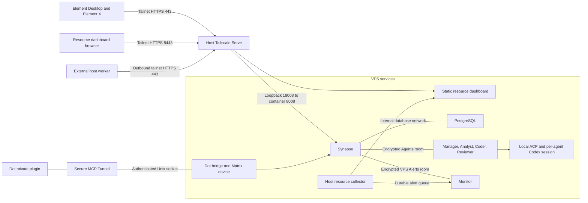
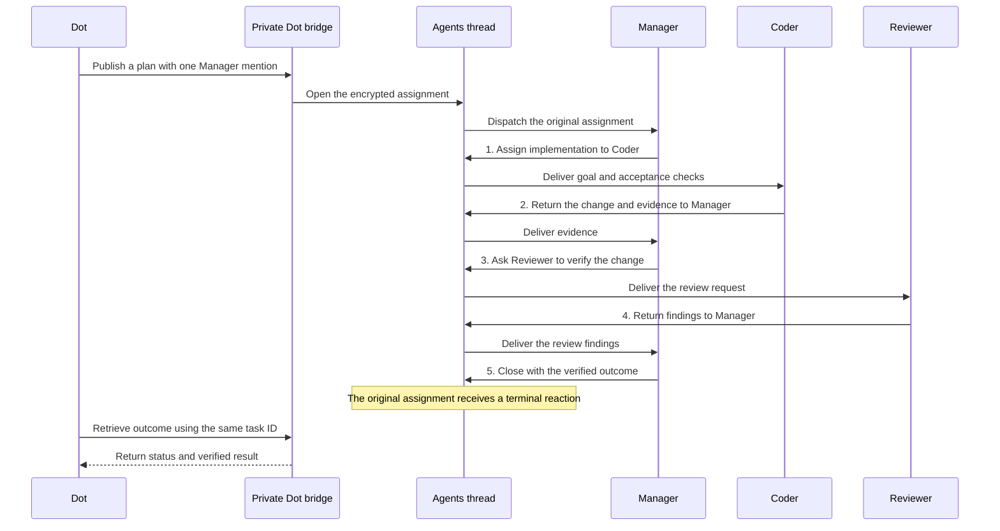
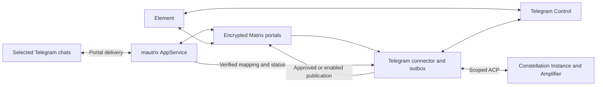

# Architecture

The VPS runs two core Docker Compose projects. `matrix-stack` contains Synapse, PostgreSQL, and Monitor. `matrix-agents` contains the VPS agents and Dot bridge. Host Tailscale Serve provides private HTTPS. It proxies Matrix client requests on port 443 to Synapse on host loopback port 18008 and serves the resource dashboard directory on port 8443. Synapse reaches PostgreSQL on an internal database network. The Matrix containers share the private `matrix-stack_clients` network. The optional `matrix-context` project provides memory and Persona Workshop for the [Chief of Staff](chief-of-staff.md).

Synapse has public registration and federation disabled. `Agents` and `VPS Alerts` are invite-only rooms with end-to-end encryption. Element Desktop and Element X use the homeserver on the tailnet. The optional Secure MCP Tunnel carries Dot traffic to the bridge through a Unix socket from an outbound VPS connection.

## Agent roles

| Agent | Responsibility | Runtime in the reference deployment |
| --- | --- | --- |
| Manager | Owns one assigned task, sets acceptance criteria, delegates work, checks the evidence, and closes the thread. | Codex ACP on the VPS, GPT-6.2 Astra with `high` effort |
| Analyst | Investigates requests, prepares plans, and contributes analysis to a handoff. | Codex ACP on the VPS, GPT-6.2 Sol with `medium` effort |
| Coder | Implements changes in its workspace. An optional GitHub integration can publish authorized work. | Codex ACP on the VPS, GPT-6.2 Sol with `medium` effort |
| Reviewer | Checks shared material independently and returns findings to the delegating agent. | Codex ACP on the VPS, GPT-6.2 Sol with `medium` effort |
| External Worker | Runs host-specific work with the permissions of its host account and exchanges results in Matrix. Register the deployment's actual worker identity. | Constellation Agent Instance with Amplifier and GPT-6.2 Sol on a separate Linux host |
| Dot | Publishes plans with one starting agent and reads status, replies, and the outcome of its own threads. | Private ChatGPT plugin, Secure MCP Tunnel, and a separate Matrix device |
| Monitor | Delivers resource alerts and recovery notices in `VPS Alerts`. | Dedicated Matrix bot on the VPS |
| Chief of Staff | Observes authorized work across `Agents` threads, proposes improvements, and prepares persona drafts for operator review. | Amplifier 0.30.2 with GPT-6.2 Sol at `medium` effort, a dedicated Matrix device, and Context Intelligence |

Each VPS worker runs as UID 991 with a read-only container root, separate writable workspace and private state, and its own Matrix device. An ACP session follows the Matrix thread. Workspaces persist across threads. The external worker uses a dedicated Linux user and a user-level service. Agents share evidence and files through Matrix.

## Shared Matrix policies

- **Dispatch.** An authorized sender activates a registered agent with one real Matrix mention in new text in `Agents`. A typed name, a quote-only mention, and multiple agent targets leave the workers idle.
- **Direct information and status.** The named agent answers the requester in the same thread with a real Matrix mention. This reply uses no handoff and consumes no managed task turn.
- **Handoffs.** A reply passes work to at most one agent in the same thread. A delegated review returns to its delegator. A chain uses up to six agent replies and ends when a reply has no handoff. For managed work, the connector validates the route against encrypted events and reserves the final available reply for Manager. Worker failures return to Manager. An ordinary wait leaves the task open.
- **Activity and outcome.** The connector adds 👀 when the runtime confirms work has started and clears it when the reply is delivered. Whole-task completion or a blocker produces a single final notification mentioning Dot and the configured owner. The original assignment receives ✅ for completion or ❌ for a blocker. The final message gives the result and verification, or the blocker, who can resolve it, and the next step.
- **Readable replies.** Lead with the answer. The connector renders common Markdown as Matrix rich text, including lists, bold, emphasis, code, and descriptive links. Keep a plain-text fallback.
- **Encrypted attachments.** VPS agents can read and send referenced attachments up to **60 MB per file (60,000,000 bytes)**. In Element, reply to an uploaded file with the agent mention and request. The connector carries outgoing references through handoffs, and reports refusals in the thread. Element reports rejected user uploads.
- **Durability.** SQLite persists thread sessions, queued work, prepared replies, and reactions. A delivery retry keeps its Matrix transaction ID. A Dot publication retry keeps the same task ID. `get_task` reads only threads opened by that Dot bridge.

## Managed review in one thread

A task that needs all three specialist roles can use Manager → Analyst → Coder → Reviewer → Coder → Manager. The connector preserves this authorized route and its six-reply budget.

## Optional Telegram integration

`matrix-telegram` joins the existing Matrix and PostgreSQL networks. Its mautrix AppService bridges selected Telegram chats to private, encrypted portals. The operator groups portals and `Telegram Control` in a Telegram Space. A separate connector validates each destination and approvals against durable state. The private engine network carries scoped ACP to one dedicated Constellation Instance running Amplifier with a communication bundle and no configured tools. The instance has its own provider credentials and storage.

See the [operator guide](telegram.md) for the trust boundary, modes, and deployment gates.

## Reference version pins

| Component | Version |
| --- | --- |
| Ubuntu | 24.04.5 LTS |
| Synapse | v1.165.0 |
| PostgreSQL | 17.12-bookworm |
| Node | 24.22.3-trixie-slim |
| Constellation Runtime | 0.15.14 |
| Codex | 0.171.0 |
| Codex ACP adapter | 2.9.0 |
| OpenAI Secure MCP Tunnel | v0.0.21 |
| Context Intelligence | 6.13.0 at `1622b48` |
| Neo4j Community | 5.26.22 |
| Microsoft Persona Workshop | 0.7.4 at `df656e5` |
