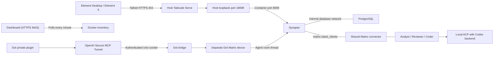
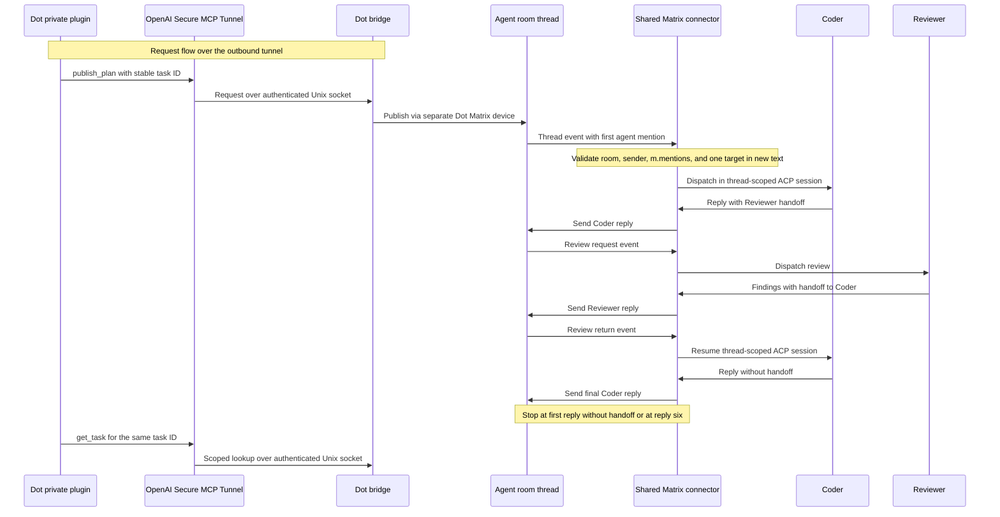

# Architecture

The handoff reports Ubuntu 24.04.5 and two Docker Compose projects, `matrix-stack` and `matrix-agents`. Host Tailscale Serve exposes Synapse at tailnet HTTPS 443 through loopback port 18008, which maps to container port 8008. The dashboard is served over HTTPS 8443 and polls Docker inventory every minute. The handoff does not identify the TLS termination component or the dashboard ingress path. Synapse and PostgreSQL share an internal database network. The bots use `matrix-stack_clients`.

Public registration and federation are disabled in the reported live deployment. Tailnet HTTPS gives authorized clients private access to the homeserver. Matrix federation is server-to-server communication and is independently disabled. The agent room and the alert room are invite-only and encrypted. Element Desktop and Element X are the desktop and mobile clients.

The Dot path uses an outbound OpenAI Secure MCP Tunnel v0.0.21. The tunnel runtime credential authorizes tunnel use. The bridge independently authenticates requests over its Unix socket. The separate Dot Matrix device uses the Dot Matrix account invited to the agent room. Keep all credential material out of this template.

The documented Dot operations are `publish_plan(task_id,title,plan,first_agent)` and scoped `get_task(task_id)`. Reuse the task ID when retrying the same publication. After an uncertain result, use the scoped lookup for the same task ID and record what it returns. The handoff leaves duplicate Matrix post behavior on retry unverified.

Analyst, Reviewer, and Coder have distinct state and persistent per-worker workspace and state under `/srv/agents/<agent>`. Workers run as UID 991 with a read-only container root and without a general shell. A workspace persists across threads, while each worker has one ACP session per thread. The local ACP backend is Codex. Unified is outside this deployment path. Model and effort are configurable.

The connector validates the room, authorized sender, a real `m.mentions` entry paired with the actual target mention in new text, and a single target per turn. Quote-only mentions and messages with two targets do not dispatch. A turn can hand off to one peer in the same thread. A delegated review returns to its delegator. For a review return that continues the chain, include a single-target handoff to the delegator in the review reply. The chain stops at reply six or at the first reply without a handoff. Confirm which replies count toward the cap against the connector source and acceptance tests. SQLite persists the cursor, queued work, session information, and prepared replies. Stable Matrix transaction IDs are used for retrying sends.

## Reported version pins

| Component | Version |
| --- | --- |
| Synapse | v1.165.0 |
| PostgreSQL | 17.12-bookworm |
| Node | 24.22.3-trixie-slim |
| Constellation Runtime | 0.15.14 |
| Codex | 0.171.0 |
| Adapter | 2.9.0 |
| OpenAI Secure MCP Tunnel | v0.0.21 |
