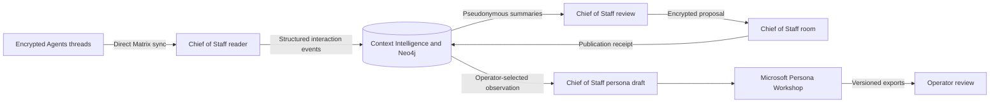

# Chief of Staff

The Chief of Staff observes how the team works across `Agents` threads. Manager remains responsible for assigning and closing individual tasks. The Chief of Staff looks for recurring handoff problems, missing verification, and blockers. It publishes an evidence-backed proposal in the private `Chief of Staff` room, with a way for the operator to test the suggested change.



The Chief of Staff joins `Agents` with its own persistent Matrix device. It reads authorized events from Element and Dot threads directly. Context Intelligence stores event and thread references, initial mentions, handoffs, and explicit outcomes. Message bodies and attachments stay in Matrix. Amplifier reviews pseudonymous interaction metadata. A closed thread is one data point. Check explicit completion, verification, and blocker evidence before drawing conclusions.

Context Intelligence and Neo4j use separate persistent volumes on a private Docker network. Context Intelligence stamps the authenticated contributor as `created_by`, independently of the role the observation is about. The reference deployment grants the Chief of Staff a scoped write identity and uses a separate read identity for operator queries. A future writer can be granted access under its own identity. The optional Neo4j Browser uses separate tailnet endpoints with Neo4j authentication.

The same Chief of Staff prepares persona drafts. [Microsoft Persona Workshop](https://github.com/microsoft/amplifier-persona-workshop) runs as a separate local Docker service with a persistent volume. It stores and exports drafts. An operator selects an archived observation and the role it supports. Amplifier receives the validated summary, and the draft records the source observation separately from the portable exports. The operator decides whether to assign a reviewed persona to an existing agent.

## Activate the components

Start from a working Matrix and agent deployment. Obtain the matching Chief of Staff base, memory, direct reader, and persona bundles from the authorized distribution referenced in the [runbook](runbook.md#prerequisites). Run the installer commands from their respective extracted bundle directories as root.

| Order | Action | Verify |
| --- | --- | --- |
| 1 | Run `bash ./chief-of-staff install`, then `/opt/matrix-agents/chief-of-staff/chief-of-staff sign-in` in an interactive terminal. Accept the `Chief of Staff` room invitation in Element. | The dedicated model login and probe succeed and the private room opens. |
| 2 | From the memory bundle, run `bash ./memory install`. | `Chief of Staff memory is ready.` |
| 3 | From the direct reader bundle, run `bash ./direct install` and invite the same Chief of Staff Matrix account to `Agents`. | Run `/opt/matrix-agents/chief-of-staff/direct/direct status`. Check that the reader has joined the authorized room. It collects new readable events after activation. |
| 4 | From the persona bundle, run `bash ./persona install`. | `Chief of Staff Persona Workshop is ready.` |

## Review team evidence

1. Open a small synthetic task in `Agents`. Let the assigned agents work and keep the resulting thread link in private operator notes.
2. Run `/opt/matrix-agents/chief-of-staff/direct/direct review` as root. This reviews recent observations from the graph and may return insufficient evidence. If it queues a proposal, wait for the encrypted message in `Chief of Staff`.
3. Compare the thread evidence with the proposal and make sure the published observation is archived in Neo4j. Use `/opt/matrix-agents/chief-of-staff/memory/memory list` to find its `observation_id`. In the graph, use `AgentsInteractionEvent` for captured interactions and `ObservationRecordedEvent` for archived proposals.

Reviews are currently started by the operator. Use the [collaboration scenarios](acceptance.md#chief-of-staff-collaboration-scenarios) to assess whether the evidence supports a workflow or persona change.

With capability routing enabled, a confirmed capability gap starts a targeted review automatically. The same reader records the event and thread reference in Context Intelligence and groups reports by capability and resource. An isolated report recommends collecting evidence or adjusting the process. Reports from at least two distinct requests can support proposing a new role. The Chief of Staff mentions the operator privately and links the evidence. The operator chooses whether to act.

## Draft a persona

Choose a role and an archived observation whose evidence supports a role-specific change. Replace `<observation-id>` with the archived ID from Context Intelligence.

After approving a new role proposed in a capability review, use `persona draft PROPOSED_ROLE cos-gap-…` with the full observation ID shown in the private room. This creates a reviewable Persona Workshop draft.

```bash
/opt/matrix-agents/chief-of-staff/persona/persona draft coder '<observation-id>'
```

The operator command runs on the VPS. When Persona Workshop exports a draft, it prints the private output directory. Review `communication.md`, `working-style.md`, and the observation reference in `draft-origin.json`. `profile.persona.json` is the portable profile for a compatible Constellation Instance. `agents-workspace.json` contains the workspace instructions export for Codex-based agents. Repeating the same role and observation should return the existing export. Keep the current agent policies when applying an approved persona.

## Recovery

The optional memory integration adds the Context Intelligence and Neo4j volumes to the encrypted Matrix backup and storage accounting. With those hooks installed, run `/opt/matrix-stack/backup` and `/opt/matrix-stack/restore-check --with-agents` from the root console. Verify `Isolated Chief of Staff memory restore passed.` in the restore output. Verify Persona Workshop volume and export coverage separately when assessing backup completeness.
